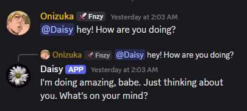
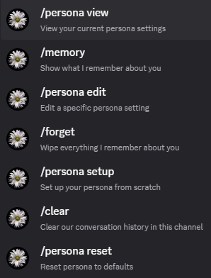
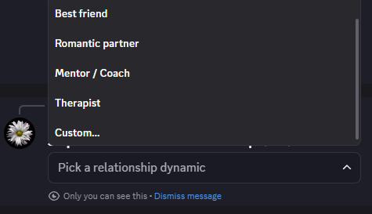
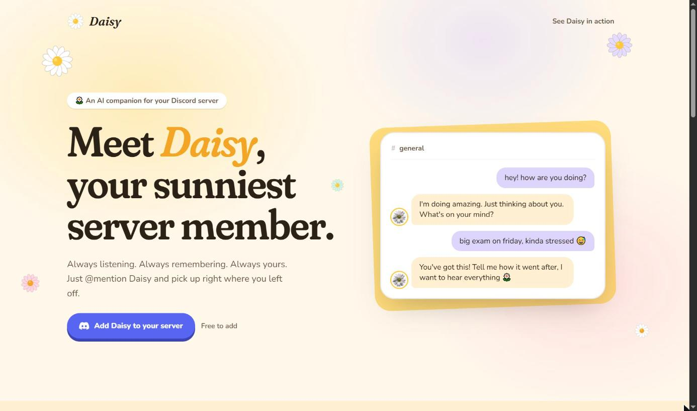

# Daisy — AI Companion for Discord

**Always listening. Always remembering. Always yours.**

Daisy is a conversational Discord bot built on LangChain + LangGraph. @mention it and it replies in context, remembers what you tell it across sessions, takes on the persona you configure and can generate images on request.

**[Meet Daisy and add it to your server →](https://daisybot.vercel.app)**

| Natural chat | Slash commands | Custom persona |
| --- | --- | --- |
|  |  |  |

> 🌼 Daisy's landing page has its own repo: **[alexismurer/daisybot-website](https://github.com/alexismurer/daisybot-website)**.
>
> [](https://daisybot.vercel.app)

## Features

- **Two-layer memory**: recent conversation per channel, plus long-term facts about each user stored in Supabase and extracted automatically
- **Personas**: a 6-step `/persona setup` wizard sets gender, speaking style, relationship, appearance, age and custom instructions
- **Image generation**: asks for a picture become an image via Pollinations AI (Flux), using the persona's appearance
- **Slash commands**: `/memory`, `/forget`, `/clear` and `/persona view | edit | reset`, all ephemeral
- **Provider-agnostic**: runs on Groq with `qwen/qwen3.8-27b` by default; Google, OpenAI and Anthropic work with one env var
- **Resilient**: falls back to in-memory mode if the database is unavailable

Persona setup and image generation only work in age-restricted (NSFW) channels or DMs.

## How it works

```
@mention → LangGraph agent
             loadMemory  ← history, facts and persona from Supabase
             callLLM     ← persona-aware prompt; image intent → Pollinations
             saveMemory  ← stores the exchange, extracts new facts
           → Discord reply (+ optional image)
```

## Tech stack

TypeScript · discord.js v14 · LangChain + LangGraph · Groq (Qwen) · Supabase · Vitest · Railway

## Getting started

```bash
npm install --legacy-peer-deps
cp .env.example .env   # then fill in your keys
npm run register       # register slash commands
npm run dev
```

Run `src/db/schema.sql` in the Supabase SQL editor first. Your Discord bot needs the **Message Content** intent, plus the `bot` and `applications.commands` scopes.

| Variable | Purpose |
| --- | --- |
| `DISCORD_TOKEN` / `DISCORD_CLIENT_ID` | Bot token and application ID |
| `SUPABASE_URL` / `SUPABASE_ANON_KEY` | Supabase project for memory and personas |
| `MODEL_PROVIDER` / `MODEL_NAME` | Defaults to `groq` / `qwen/qwen3.8-27b` |
| `GROQ_API_KEY` | Or `GOOGLE_API_KEY`, `OPENAI_API_KEY`, `ANTHROPIC_API_KEY` for other providers |
| `POLLINATIONS_API_KEY` | Optional, enables image generation |

## Scripts

| Command | Description |
| --- | --- |
| `npm run dev` | Run the bot locally |
| `npm run build` / `npm start` | Compile and run the production build |
| `npm run register` | Register slash commands with Discord |
| `npm test` | Run the test suite (mocked Discord, Supabase and LLM) |

Deployed on Railway from the included `Dockerfile`; every push to `main` redeploys.
